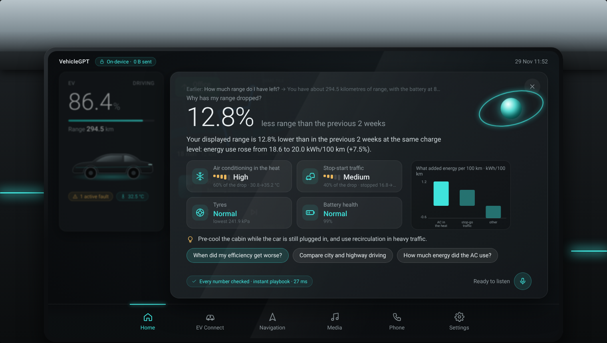
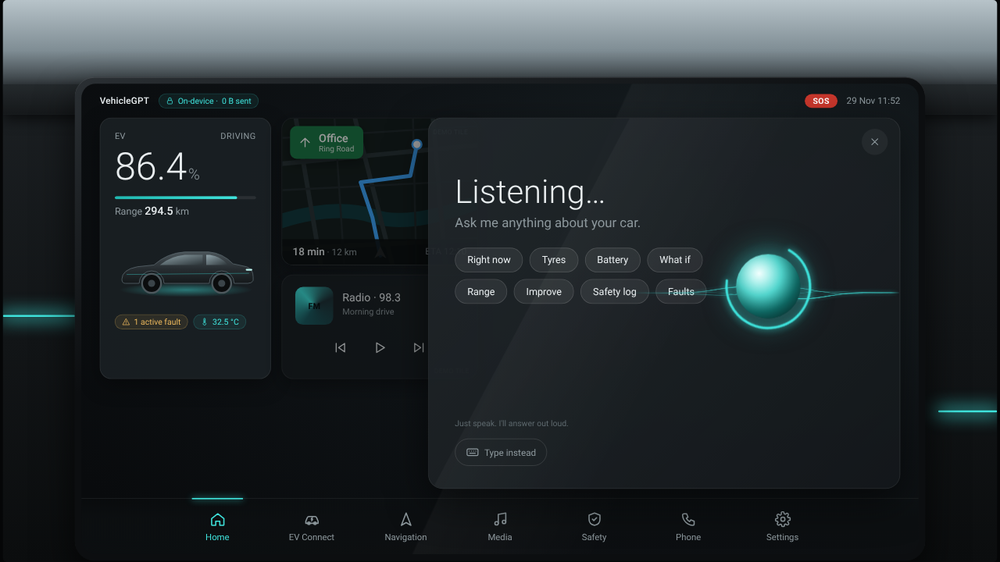

# VehicleGPT — ask the vehicle, get evidence, not guesses

**Team Nexus · BITS Pilani, K K Birla Goa Campus** — Shreshth Singhal (Team Leader), Shaurya Awasthi, Subhranshu Mitra
Telipoort Season 4 (Tata Elxsi) · Case Study 5: Natural Language Vehicle Information using an On-Device SLM/LLM

An on-device assistant that keeps a searchable memory of everything a vehicle does (CAN, SOME/IP, Android VHAL, QNX logs,
ADAS, camera metadata, diagnostics) and answers plain-language questions such as *"Why has my range dropped?"* in under
2 seconds on a 2-core / 2 GB ARM target, with **no cloud** and **no path to the vehicle's safety domain**.

> The small language model interprets the question; a deterministic data engine computes the answer; a verifier
> checks every number against the data before it is shown.

## Layout
| Folder | Layer |
|---|---|
| `twin/` | Digital twin: simulated and recorded vehicle data with injected faults |
| `sense/` | Listen-only data collection and normalisation to COVESA VSS |
| `remember/` | Tiered on-device storage (weeks of history) |
| `reason/` | Intent router, SLM planner, analysis playbooks, verifier |
| `ask/` | User interfaces for drivers, service engineers, fleets and validation teams |
| `safety/` | Isolation and privacy checks |
| `eval/` | Golden questions, accuracy and performance benchmarks |
| `profiles/` | Hardware profiles (Lite / Plus / Pro) |
| `docker/` | Containers, including the 2 CPU / 2 GB constrained run |

## Quick start (Windows, macOS or Linux)
```
git clone https://github.com/shreshthsinghal/vehiclegpt
cd vehiclegpt
python scripts/check_setup.py
```

## Phase 1: digital twin (simulated vehicle data)
```
pip install -r requirements.txt
python -m twin.generate          # 56 days of data in ~1 minute -> data/twin/
python -m twin.inspect_data      # see one decoded sample from every source
```
Live demo (two terminals):
```
python -m twin.monitor                                   # terminal 1: receive-only dashboard
python -m twin.replay --day 55 --start 18:00 --minutes 5 # terminal 2: replay yesterday's rainy drive
```
| Output | Format |
|---|---|
| `data/twin/can/dayNN.blf` | CAN + CAN-FD frames (Vector BLF), decoded with `twin/nexus_ev.dbc` (19 messages, 177 signals) |
| `data/twin/someip/` | SOME/IP notifications (thermal, ADAS, camera services) with real 16-byte headers |
| `data/twin/vhal/` | Android Automotive VHAL property events |
| `data/twin/qnx/` | QNX slog2-style system log |
| `data/twin/uds/` | UDS diagnostic trouble codes (service 0x19/0x59) |
| `data/twin/truth/` | Answer key for grading - never read by VehicleGPT |

Scenarios and planted faults: `twin/fault_catalogue.yaml`. Exam questions: `eval/golden_questions.yaml`.

## Phase 2: SENSE (listen-only collection, normalisation, events, black box)
```
python -m sense.ingest --backfill     # all recordings -> data/sense/ (events, logs, black-box case files) in ~45 s
```
Live (two terminals): `python -m sense.ingest --live`, then `python -m twin.replay --day 55 --start 18:03 --minutes 3`.

| Piece | What it does |
|---|---|
| `sense/adapters/sources.py` | One listen-only adapter per source: CAN/CAN-FD (DBC), SOME/IP (header-validated), Android VHAL, QNX slog2, UDS DTCs |
| `sense/mappings.yaml` | Every native name -> COVESA VSS path (192 paths seen); location coarsened to ~1 km |
| `sense/engine.py` | 1 Hz normalised snapshot; event miner (trips, charges, warnings, DTCs, ADAS, data gaps, contextual anomalies, Drain3 log templates); black box (-60 s / +10 s case files) |
| `safety/guards.py` | `ListenOnlyBus`: any CAN transmit raises and is counted (must stay 0) |

## Phase 3: REMEMBER (tiered on-device memory)
```
python -m remember.build      # SENSE -> data/store/vehicle.db (+ encrypted case files) and a size report
```
| Tier | Content | Kept | Measured (8 weeks, 1.4 h/day) |
|---|---|---|---|
| HOT | last 10 min of 1 Hz snapshots, RAM ring | 10 min | in memory |
| WARM | 1 Hz, all 192 signals, 10-min compressed blocks (delta-of-delta + quantised deltas + zlib, lossless) | 14 days | 0.49 bytes/reading |
| COLD | 1-minute min/max/mean/count per signal | 400 days | 0.41 MB/day |
| PINNED | black-box case files | forever | ~5 KB each |

Plus trips, charges, events, logs (FTS5 keyword search), DTC descriptions. Time-series blocks and case files are
AES-256-GCM encrypted (key file stands in for the vehicle HSM). Total on disk: ~36 MB for 8 weeks.

## Phase 4: REASON (router, playbooks, verifier, on-device SLM planner)
```
python -m reason.ask                       # ask questions in the terminal
python -m eval.run_golden                  # grade against the answer key
python scripts/get_model.py                # optional: download Qwen3-0.6B (one time) ...
python scripts/start_llm.py                # ... and run llama-server on 127.0.0.1 for the SMART path
```

## Phase 5: ASK (offline HMI for driver, service, fleet, validation)
```
python -m ask.server                       # driver head-unit: http://127.0.0.1:8765  · engineer console: /console
```
Role PINs for the console (service, fleet, validation) are printed at start-up.

## Phase 7: head-unit screen and on-device voice


The driver's screen is styled like a car head unit. You tap the orb (or press **Space**) and ask a question. The orb
*listens*, then *thinks* (Understanding → Reading memory → Checking every number), then *answers* with:
- one big number;
- factor cards: for example, what is hurting your range, rated High/Medium;
- a small chart, a tip, and follow-up questions;
- a **How I know** drawer that shows the evidence.

The screen never computes numbers itself: `ask/present.py` copies them from verified facts, and `ui_verified`
re-checks every number the screen shows.

| Inspiration feature | How it's done within the brief's limits |
|---|---|
| Glass panels, teal orb, animations | One offline HTML file (CSS + SVG + canvas): no web fonts, CDNs or images. Decorative motion pauses after 15 s idle (0% CPU); *Eco motion* turns it off. |
| Voice in | Mic → WAV → `/api/listen` on 127.0.0.1 → **whisper.cpp** (base.en, 142 MB). The model loads only while transcribing; audio goes to a temp file that is deleted after transcription. No cloud speech API. Measured on 2 ARM cores: **12/12 spoken questions gave the same analysis as typed**, 6% word errors, **1.4 s** median, 222 MB peak only while transcribing. |
| Voice out | **Warm on-device voice**: Kokoro-82M (Apache-2.0, voice `af_heart`) served by `/api/speak` on 127.0.0.1, or Piper on very small boards. If no voice model is installed, the browser uses an on-device system voice only (never a network voice). |
| "What's affecting your range" | Real Shapley-style attribution from the `range_drop` playbook (AC in heat vs stop-start traffic), with tyres and battery ruled out. |
| Map / music tiles | Drawn placeholders marked *DEMO TILE* (no Google Maps, no real songs or album art). |
| Driver distraction | *Glance mode while driving*: headline + two cards + voice; full details when parked. |
| Safety | Refusals show a shield card; the assistant is read-only (CAN TX = 0). |

Turn on voice input once: `python scripts/get_model.py --speech` (Windows downloads whisper.cpp automatically).
Demo framing: `?bezel=0` removes the dashboard frame, **B** toggles it, `?fresh=1` replays onboarding, and `?q=...` asks directly.
All 14 states are in `docs/screens/hmi/`.

### Voice-first (no keyboard needed)


- **Tap the orb, press Space or V, and just speak.** The mic stops by itself after 1.2 s of silence. The screen shows
  *You said …* so the driver can see what was heard. The keyboard is hidden behind **Type instead**; it opens by itself
  only if speech isn't installed or the mic is blocked.
- **The answer is spoken in a warm, human style** (`present.warm`): "Your tyres look good: all four are between 243 and
  245 kilopascals." instead of reading out the screen. Units, fault codes and decimals are turned into words a person
  would say (`tts.for_ear`). Emergencies use a slower, *calm* style and read every step, ending with "call one one two".
  Every number in the spoken line is checked against the verified facts, exactly like the screen.
- **Speech starts quickly:** the answer is split into short sentences, the first chunk is kept to a few words, and the
  next sentence is prepared while the current one plays. Common openers are made at start-up.
- **Conversation mode** (on by default, toggle in Settings): after answering, the assistant offers one follow-up
  ("Shall I show your safety log?") and listens for about 6 s. *Yes* runs it, *No / thanks* or silence closes with
  "Happy to help. Drive safe.", and anything else is treated as a new question. Not used after emergencies.
- **Barge-in:** tap the orb while it is speaking to interrupt and ask something else.

Turn on the warm voice once: `python scripts/get_model.py --voice` (Kokoro, about 355 MB) or `--voice piper` (about 60 MB).
Measured here (2 x86 vCPUs, `python -m eval.tts_eval`): first spoken words after **1.6 s median** (2.5 s max), real-time factor
0.94, 650 MB peak. The screen answer itself appears in under 0.2 s, so the driver reads while the voice starts. CI times
the same on 2 ARM cores.

## Present state, scenarios, advice and safety (fix round after user testing, 23 Nov)
| Ask | What happens |
|---|---|
| "What is the tyre pressure now?", "Is the camera fine?", "How is my car right now?" | **Signal catalogue** (`reason/catalogue.py`): 48 recorded signals in plain words, current value from the WARM tier. A rear camera isn't recorded, so the answer says so and reports the front camera instead. |
| "Can I drive 180 km at 100 km/h?", "Range with the AC off?", "80 vs 110 km/h?", "How long to charge to 80%?" | **What-if** on a consumption model fitted on this car's own 120 trips (R² 0.95; AC power vs outside temperature R² 0.85). Usable battery (60.0 kWh) comes from the charging sessions. Trips needing more than one charge get a charging-stop plan. |
| "How can I improve my range?" | **Advice with numbers** from the same model (e.g. gentler AC +47 km per charge; 10 km/h slower on the highway = 6.7% less per highway km). |
| "Show my safety log" | Timeline of warnings, faults, early signs, ESC interventions, very hard braking and lane-assist drop-outs, with severity. |
| "My brakes aren't working!" / **SOS** button | **Emergency guide** (`reason/emergency.yaml`): 8 topics with fixed steps written from cited sources (NFPA, NHTSA, US DOT, Kia owner's manual, weather.gov, Mission Safer Roads). Never AI-generated; shown as a red card with 112, read aloud, plus the car's live state. VehicleGPT never operates the car. |
| Unclear questions | The screen shows **"I understood this as … Not what you meant?"** with alternatives, instead of silently answering the nearest thing. |

The on-device SLM now chooses among 18 analyses and 53 signal names. For what-if questions it fills a second tiny form
(distance, speed, AC, charge target); for emergencies, a topic form. Emergency steps are never generated.

## Status
Phase 7a (head-unit screen + voice) complete. Tests: `python -m pytest -q` (24 tests, ~3 min).
